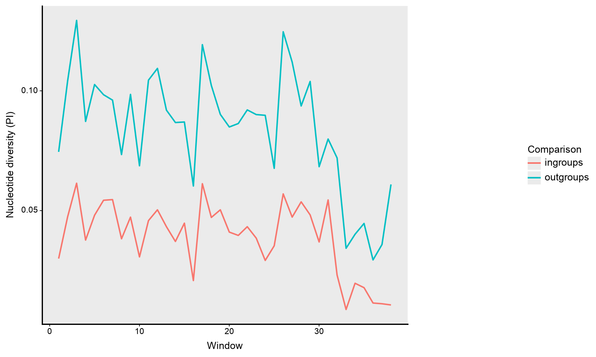
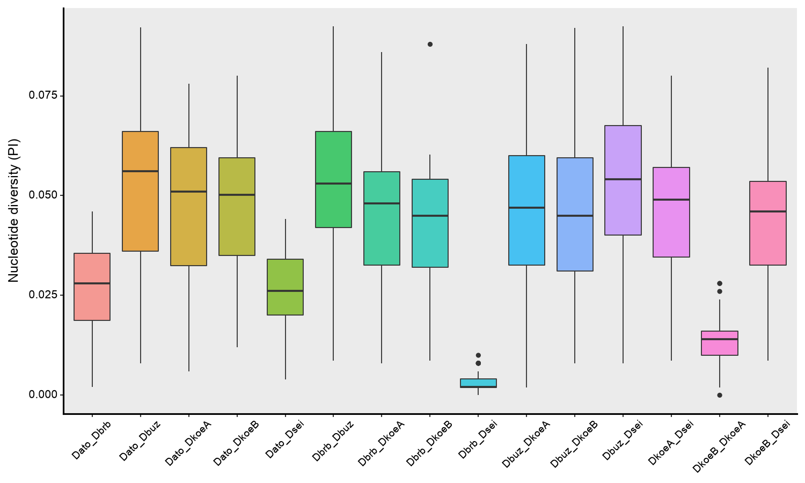

# NDEV: Nucleotide Diversity Estimation and Visualization

NDEV estimates nucleotide diversity (π; Nei, 1987) along a DNA alignment using sliding windows, both for the whole set of sequences and for every pair of sequences, and plots the results. I wrote it during my PhD to analyze nucleotide diversity along mitochondrial genomes of the *Drosophila buzzatii* cluster, as part of [Moreyra et al. (2019, *PLoS ONE*)](https://doi.org/10.1371/journal.pone.0220676).

---

## How π is calculated

For each window, every pair of sequences is compared position by position. The proportion of different sites is calculated only over valid sites (A, C, G or T in both sequences): gaps, `N` and ambiguous bases are excluded from that pair (pairwise deletion). π of the window is the mean of these proportions across all pairs.

The file [`data_example/nei_example.fasta`](data_example/nei_example.fasta) reproduces the textbook example of four 10 bp sequences, for which π = 0.167. NDEV returns the same value:

```bash
python GenDivEst.py --mode calculate --infile data_example/nei_example.fasta --pilabel nei --prefix nei --wsize 10 --woverlap 0
```

---

## Requirements

Python 3 with `numpy`, `pandas`, `matplotlib` and `plotnine`. For example, with conda:

```bash
conda create -n ndev -c conda-forge python=3.11 numpy pandas matplotlib plotnine
conda activate ndev
```

---

## Usage

NDEV has three modes. Run `python GenDivEst.py -h` for the full list of options.

### `calculate`: π along an alignment

```bash
python GenDivEst.py --mode calculate --infile data_example/ingroups.fasta --pilabel ingroups --prefix example_output/ingroups
```

- `--infile`: alignment in FASTA format (all sequences with the same length). To convert other formats, see [scripts_bioinformatics](https://github.com/niconm89/scripts_bioinformatics).
- `--pilabel`: label for this alignment; it is used as the curve name in `lineplot`.
- `--wsize`: window size. Default: 500.
- `--woverlap`: overlap between consecutive windows. Default: 100.
- `--prefix`: prefix (with path, if needed) of the output files.

Outputs:

- `<prefix>.nuc-diversity.txt`: π per window for the whole alignment.
- `<prefix>.pairwise.tsv`: π per window for each pair of sequences.

### `lineplot`: π along the alignment for one or more alignments

```bash
python GenDivEst.py --mode lineplot --pifiles example_output/ingroups.nuc-diversity.txt example_output/outgroups.nuc-diversity.txt --prefix example_output/ingroups_vs_outgroups --xlabel 'Window' --ylabel 'Nucleotide diversity (PI)' --figsize 6 10 --labels_fontsize 12 --axis_fontsize 10 10 --dpi 150
```



### `boxplot`: distribution of π for each pair of sequences

```bash
python GenDivEst.py --mode boxplot --pairwise example_output/ingroups.pairwise.tsv --prefix example_output/ingroups --ylabel 'Nucleotide diversity (PI)' --figsize 6 10 --labels_fontsize 12 --axis_fontsize 9 10 --rotation 45 0 --dpi 150
```



- `--select_comp`: plot only some comparisons (for example, `Dato_Dbuz Dbrb_Dsei`).
- `--violin`: violin plot instead of boxplot.
- `--jittler`: add the points of each window.
- `--boxes_colors`: one color per comparison.
- `--ylimit`: limits of the y axis.

Options shared by both plot modes: `--title`, `--xlabel`, `--ylabel`, `--title_fontsize`, `--labels_fontsize`, `--axis_fontsize`, `--rotation`, `--linewidth`, `--linestyle`, `--alpha`, `--figsize` and `--dpi`.

---

## Example data

`data_example/` contains two alignments of mitochondrial genomes (about 15 kb): `ingroups.fasta`, with six sequences of species of the *Drosophila buzzatii* cluster, and `outgroups.fasta`, with ten sequences that add other *Drosophila* species. All the files in `example_output/` were generated with the commands above.

---

## Limitations

- Some options listed in `-h` are not implemented yet: `--labels`, `--legend`, `--legend_fontsize`, `--lines_colors`, `--theme_color`, `--grid` and `--xlimit`. In `lineplot`, curve names come from `--pilabel`.
- The last window of an alignment can be shorter than `--wsize`.
- Comparisons are done position by position in Python, so very large alignments with many sequences can be slow.

---

## Citation

NDEV was developed for and used in:

Moreyra N.N. et al. (2019). What does mitogenomics tell us about the evolutionary history of the *Drosophila buzzatii* cluster (*repleta* group)? *PLoS ONE*, 14(11), e0220676. [https://doi.org/10.1371/journal.pone.0220676](https://doi.org/10.1371/journal.pone.0220676)

---

## License

[GPL-3.0](LICENSE)

## Contact

Nicolás Nahuel Moreyra · [niconm89@gmail.com](mailto:niconm89@gmail.com)